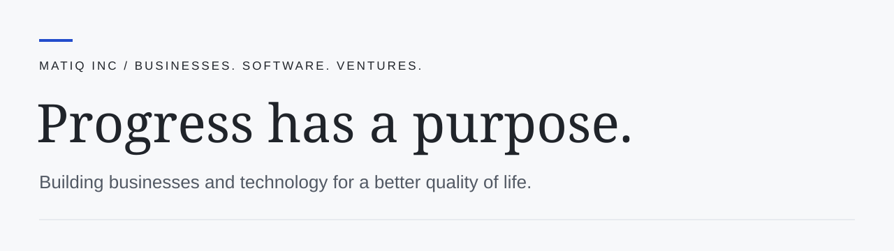

[Website](https://matiqinc.com) · [Explore our software](#software-you-can-explore) · [Talk with us](mailto:hello@matiqinc.com)

We build businesses and technology for a better quality of life. Our work connects the systems a business depends on, the people using them, and the time good tools can give back.

This is the public home for software we build and share.

## Software you can explore

| Project | What it helps you do | Start here |
|---|---|---|
| **[MatiQ Solutions](https://github.com/GoMatiQ-inc/matiq-solutions)** | Choose local desktop tools from one suite. Install only the tools you want. | [Downloads](https://github.com/GoMatiQ-inc/matiq-solutions/releases) · [Documentation](https://github.com/GoMatiQ-inc/matiq-solutions#readme) |
| **[MatiQ Voice](https://github.com/GoMatiQ-inc/matiq-voice)** | Dictate in English and work with local meeting recordings and notes. Speech recognition runs on your computer. | [Downloads](https://github.com/GoMatiQ-inc/matiq-voice/releases) · [Documentation](https://github.com/GoMatiQ-inc/matiq-voice#readme) |
| **[MatiQ Companion](https://github.com/GoMatiQ-inc/matiq-companion)** | Chat with a local AI model, organize projects, and choose which tools each conversation may use. | [Downloads](https://github.com/GoMatiQ-inc/matiq-companion/releases) · [Documentation](https://github.com/GoMatiQ-inc/matiq-companion#readme) |
| **[MatiQ CopyCat](https://github.com/GoMatiQ-inc/matiq-copycat)** | Capture a desktop or browser workflow, edit its illustrated steps, and export a useful guide. | [Downloads](https://github.com/GoMatiQ-inc/matiq-copycat/releases) · [Documentation](https://github.com/GoMatiQ-inc/matiq-copycat#readme) |

**Useful software. Made by MatiQ.** Each project maintains its own source, release notes, installation instructions and support issues. Check its releases for the actual installers, supported operating systems and current limitations. Local models, where needed, download separately.

These projects are **source available** under their respective MatiQ No-Sale licenses. Personal and internal business use are permitted; paid resale, hosting and bundling require separate permission. They are not OSI-approved open-source licenses. Third-party dependencies and model weights retain their own terms.

## The MatiQ family

Different kinds of expertise, connected by the work they help improve.

| Part of the family | Focus |
|---|---|
| **MatiQ Technologies** | Software engineering, AI systems, integrations and data infrastructure. |
| **MatiQ Studio** | Brand identity, websites, content and digital marketing. |
| **MatiQ Academy** | Practical AI training and workshops for teams. |
| **MatiQ Books Plus** | Bookkeeping, cleanup and financial reports explained clearly. |
| **MatiQ Solutions** | Useful software, from a shared desktop suite to individual tools. |

## Work with us

Start with the work you want to make better. For a business inquiry, [talk with us](mailto:hello@matiqinc.com) or visit [MatiQ Inc](https://matiqinc.com).

For help with an app, open an issue in its repository. Include the app version, operating system and steps to reproduce the problem, and remove personal information, recordings and credentials before posting.

*Making all things improve Quality.*
